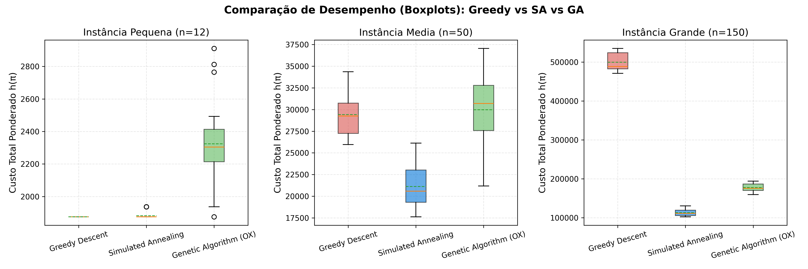
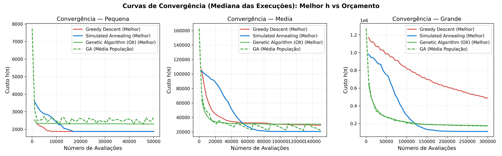
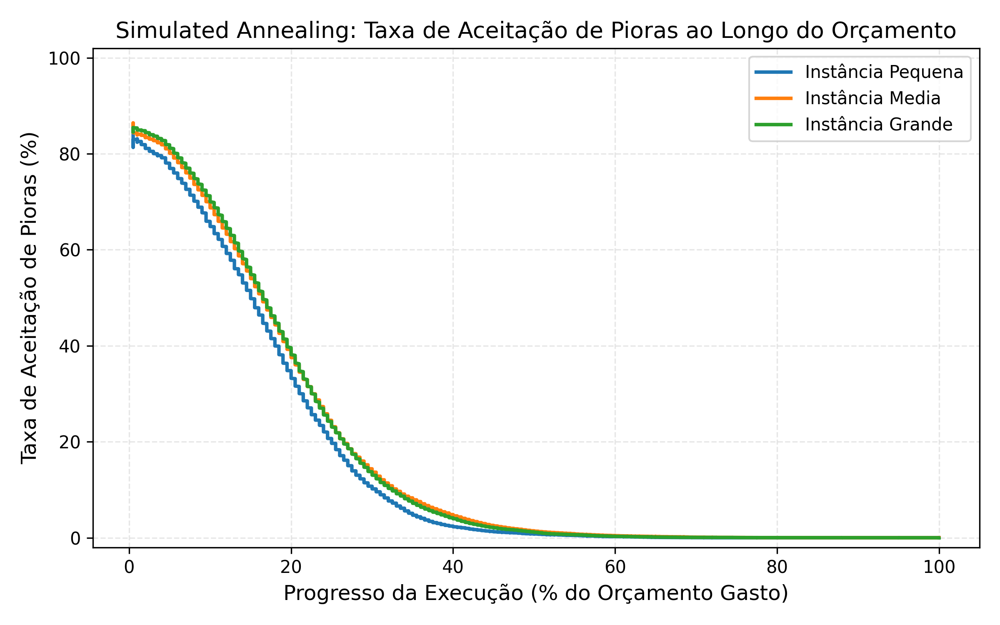
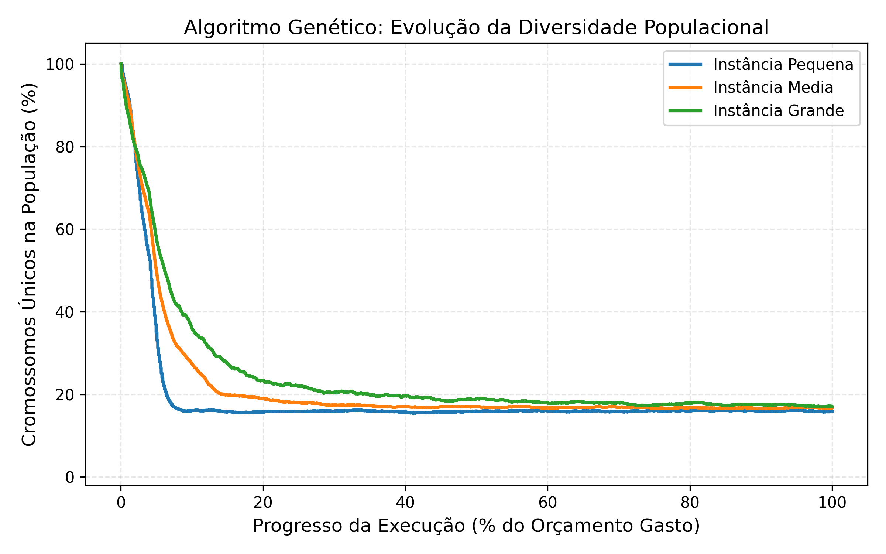

# Relatório Técnico — Trabalho Prático 2: Busca Local e Algoritmo Genético
**Sequenciamento de Manutenção Preventiva de Ativos com Penalidade por Atraso Ponderado**  
*Fundamentos de Inteligência Artificial — DCC / UFMG (Outubro de 2026)*

---

## Resumo
Este trabalho apresenta a modelagem, implementação e estudo comparativo entre duas heurísticas de Busca Local (**Greedy Descent com Random Restart** e **Simulated Annealing**) e uma metaheurística populacional (**Algoritmo Genético**) para o problema de sequenciamento de rotas de manutenção preventiva de ativos elétricos com penalidade por atraso regulatório ponderado (*Total Weighted Tardiness*). O espaço de busca combinatório possui $n!$ soluções. Desenvolveu-se uma arquitetura estritamente desacoplada (*algoritmo $\neq$ problema*) com avaliação incremental em tempo $O(n - k)$ efetivo. Validou-se formalmente a função de aptidão com busca exata na instância pequena ($h^* = 1.875$) e compararam-se as vizinhanças de *Swap*, *Insertion* e *2-opt*. Sob protocolo experimental rigoroso com orçamento fixo de avaliações ($50.000$, $150.000$ e $300.000$) e sementes controladas, analisou-se o equilíbrio entre exploração e intensificação, a perda de diversidade e a inversão de ranking decorrente do efeito de escala, sustentada por testes não paramétricos de Mann–Whitney.

---

## 1. Introdução e Modelagem do Problema

### 1.1 Cenário Operacional e Formul\documentclass[11pt,a4paper]{article}

\usepackage[utf8]{inputenc}
\usepackage[T1]{fontenc}
\usepackage[brazil]{babel}
\usepackage{amsmath,amssymb,amsfonts}
\usepackage{booktabs}
\usepackage{geometry}
\usepackage{microtype}
\usepackage{hyperref}
\usepackage{xcolor}
\usepackage{tabularx}
\usepackage{caption}
\usepackage{graphicx}

\geometry{
  top=2.0cm,
  bottom=2.0cm,
  left=2.0cm,
  right=2.0cm
}

\hypersetup{
  colorlinks=true,
  linkcolor=blue!70!black,
  citecolor=blue!70!black,
  urlcolor=blue!70!black
}

\title{\textbf{Trabalho Prático 2: Busca Local e Algoritmo Genético}\\\large Sequenciamento de Manutenção Preventiva de Ativos com Atraso Ponderado}

\author{
  \textbf{Alunos do Grupo:} \\[0.4em]
  Jaime Guimarães \\
  Luigi Jacob\\
  Gilberto de Carvalho \\
  Yaggo Teixeira \\[0.6em]
  \small Universidade Federal de Minas Gerais (UFMG)
}

\date{Belo Horizonte, Outubro de 2026}

\begin{document}

\maketitle

\begin{abstract}
Neste trabalho, comparamos três abordagens de otimização combinatória: Greedy Descent com Random Restart, Simulated Annealing e Algoritmo Genético. Todas aplicadas ao problema de sequenciamento de rotas de manutenção preventiva de ativos elétricos com minimização de atraso ponderado total (\textit{Total Weighted Tardiness}). A implementação desacopla o problema dos algoritmos por meio de uma interface comum de avaliação, incorporando avaliação incremental para redução de tempo de execução. Sob um orçamento rigoroso de avaliações ($50.000$, $150.000$ e $300.000$) e sementes controladas para $30$ e $10$ execuções independentes, analisamos a dinâmica de exploração e intensificação, a perda de diversidade da população no AG e o impacto da escala do problema sobre a eficiência relativa dos métodos, validando as conclusões com testes de Mann--Whitney. O código e os dados estão disponíveis no repositório: \url{https://github.com/SkanyCst/tp2-Busca-Local-Algoritmo-Genetico}.
\end{abstract}

\section{Introdução e Modelagem do Problema}

\subsection{Contexto e Definição Matemática}
Uma concessionária precisa realizar a manutenção preventiva de $n$ ativos distribuídos geograficamente. Uma única equipe parte da base localizada em $(0,0)$ no instante zero e atende um ativo por vez, sem necessidade de retornar à base ao final do turno.

Para cada ativo $j \in \{1, \dots, n\}$, conhecem-se a posição $(x_j, y_j)$, a duração do serviço $p_j$ (em horas), o prazo regulatório $d_j$ e a criticidade $w_j$ (custo por hora de atraso). O tempo de deslocamento entre dois nós $i$ e $j$ é dado pela distância euclidiana arredondada:
\begin{equation}
t_{ij} = \mathrm{round}\left(\sqrt{(x_i - x_j)^2 + (y_i - y_j)^2}\right) \text{ horas, com base } \pi_0 = 0 \text{ e } p_0 = 0
\end{equation}

Uma solução candidata é uma permutação $\pi = (\pi_1, \pi_2, \dots, \pi_n)$. O tempo de conclusão do $k$-ésimo ativo visitado é calculado recursivamente:
\begin{equation}
C_{\pi_k} = C_{\pi_{k-1}} + t_{\pi_{k-1}\pi_k} + p_{\pi_k}, \quad \text{com } C_{\pi_0} = 0
\end{equation}

A função de avaliação a ser minimizada é a penalidade total por atraso:
\begin{equation}
h(\pi) = \sum_{j=1}^n w_j \cdot \max(0, \, C_j - d_j)
\end{equation}

O problema lida com restrições flexíveis (\textit{soft constraints}): toda permutação é viável. A complexidade decorre do conflito entre dois critérios gulosos opostos: ir ao ativo mais próximo (economizando tempo de percurso) ou atender ao ativo mais urgente (evitando multas elevadas).

\subsection{T1 - Validação da Função de Avaliação}
Antes dos experimentos, a função de avaliação $h(\pi)$ foi validada em relação aos gabaritos do edital:

\begin{table}[htbp]
\centering
\small
\caption{Validação da função de fitness $h(\pi)$ com os casos de teste do enunciado.}
\label{tab:t1}
\begin{tabular}{lcccc}
\toprule
\textbf{Caso de Teste} & \textbf{Configuração da Solução} & \textbf{Esperado} & \textbf{Obtido} & \textbf{Status} \\
\midrule
Figura 1 ($n=4$) & Rota Gulosa $\pi = (1, 4, 2, 3)$ & $39,0$ & $39,0$ & Aprovado \\
Figura 1 ($n=4$) & Rota Ótima $\pi^* = (1, 4, 3, 2)$ & $22,0$ & $22,0$ & Aprovado \\
\texttt{manutencao\_pequena.txt} ($n=12$) & Identidade $\pi = (1, 2, \dots, 12)$ & $4.366,0$ & $4.366,0$ & Aprovado \\
\texttt{manutencao\_pequena.txt} ($n=12$) & Ótimo Global Exato ($\pi^*$) & $1.875,0$ & $1.875,0$ & Aprovado \\
\bottomrule
\end{tabular}
\end{table}

A coincidência exata dos valores confirmou a correção do arredondamento das distâncias e do somatório de penalidades.

\section{Arquitetura e Vizinhanças (T2)}

\subsection{Separação Algoritmo / Problema e Avaliação Incremental}
Seguindo o requisito de desacoplamento, os algoritmos interagem com o problema através da classe \texttt{Evaluator}, que centraliza o controle do orçamento e interrompe a execução com \texttt{BudgetExhaustedException} ao esgotar o limite de avaliações. Testes automáticos via AST garantem que nenhum algoritmo acessa atributos internos do problema.

Como $h(\pi)$ depende do histórico temporal acumulado ao longo da rota, qualquer alteração a partir do índice $k$ não altera os tempos de conclusão nem as penalidades dos ativos no prefixo $[0, \dots, k-1]$. A avaliação incremental reaproveita esse prefixo e recalcula apenas o trecho $k \dots n$. Em nossos testes, o ganho de tempo de parede medido foi de $1,06\times$ na instância pequena, $1,17\times$ na média e $1,20\times$ na grande, preservando rigorosamente a contagem de avaliações do orçamento.

\subsection{T2 - Comparação dos Operadores de Vizinhança}
Implementamos os três operadores clássicos de vizinhança sobre permutações:
\begin{itemize}
    \item \textbf{Swap (Troca):} Troca de posição de dois ativos distintos $i$ e $j$. Tamanho: $|\mathcal{V}_{\text{swap}}| = n(n-1)/2$.
    \item \textbf{Insertion (Realocação):} Retira o ativo na posição $i$ e insere na posição $j$. Eliminando o caso redundante $j = i-1$, o tamanho é $|\mathcal{V}_{\text{insertion}}| = (n-1)^2$.
    \item \textbf{2-opt (Inversão):} Inverte a ordem do segmento entre $i$ e $j$. Tamanho: $|\mathcal{V}_{\text{2-opt}}| = n(n-1)/2$.
\end{itemize}

A Tabela~\ref{tab:t2} resume o teste comparativo executando o Greedy Descent com Random Restart sob o mesmo orçamento de $20.000$ avaliações:

\begin{table}[htbp]
\centering
\small
\caption{Comparação das três vizinhanças sob Greedy Descent (Orçamento = $20.000$ avaliações).}
\label{tab:t2}
\begin{tabular}{llccccc}
\toprule
\textbf{Instância} & \textbf{Vizinhança} & \textbf{Tamanho Teórico} & \textbf{Melhor $h$} & \textbf{Descidas} & \textbf{Passos} & \textbf{Tempo (s)} \\
\midrule
Pequena ($n=12$) & Swap      & $66$    & $\mathbf{1.875,0}$ & $38$ & $264$ & $0,087$ \\
Pequena ($n=12$) & Insertion & $121$   & $\mathbf{1.875,0}$ & $20$ & $145$ & $0,093$ \\
Pequena ($n=12$) & 2-opt     & $66$    & $\mathbf{1.875,0}$ & $32$ & $270$ & $0,095$ \\
\midrule
Média ($n=50$)   & Swap      & $1.225$ & $48.256,0$         & $0$  & $16$  & $0,297$ \\
Média ($n=50$)   & Insertion & $2.401$ & $84.032,0$         & $0$  & $8$   & $0,297$ \\
Média ($n=50$)   & 2-opt     & $1.225$ & $\mathbf{46.711,0}$ & $0$  & $16$  & $0,306$ \\
\midrule
Grande ($n=150$) & Swap      & $11.175$ & $1.169.591,0$     & $0$  & $1$   & $0,851$ \\
Grande ($n=150$) & Insertion & $22.201$ & $1.289.488,0$     & $0$  & $0$   & $0,844$ \\
Grande ($n=150$) & 2-opt     & $11.175$ & $\mathbf{1.013.101,0}$ & $0$  & $1$   & $0,882$ \\
\bottomrule
\end{tabular}
\end{table}

\paragraph{Vizinhança Adotada:} O operador \textit{Insertion} possui tamanho que cresce como $(n-1)^2 \approx 2n^2$, consumindo avaliações rapidamente e permitindo poucos passos de melhora. Os operadores \textit{Swap} e \textit{2-opt} têm tamanho idêntico ($n(n-1)/2$). Escolhemos o \textit{Swap} como padrão para as buscas estocásticas devido ao seu baixo overhead por movimento e reaproveitamento médio de prefixo em torno de $n/3$, com perturbação atômica controlada.

\section{Algoritmos Implementados}

\subsection{Algoritmo A - Greedy Descent com Random Restart}
Inicia em uma permutação aleatória e realiza movimentos de descida escolhendo o sucessor de menor custo estrito ($\Delta h < 0$). Quando nenhum vizinho melhora o custo, o algoritmo atinge um ótimo local, registra a solução encontrada e reinicia em uma nova permutação aleatória. Adotamos a variante \textit{Best Improvement}, que varre toda a vizinhança a cada passo.

\subsection{Algoritmo B - Simulated Annealing}
Sorteia vizinhos por \textit{Swap}. Se o vizinho for melhor ($\Delta h \le 0$), ele é aceito imediatamente. Se for pior ($\Delta h > 0$), é aceito com probabilidade de Gibbs:
\begin{equation}
P(\text{aceitar}) = \exp\left(-\frac{\Delta h}{T}\right)
\end{equation}
Usamos o resfriamento geométrico $T \leftarrow \alpha T$. As temperaturas foram calibradas medindo-se a magnitude média dos saltos de piora $\overline{\Delta h^+}$ em cada instância:
\begin{itemize}
    \item Pequena ($n=12$): $T_0 = 4.000$, $T_f = 0,1$, $\alpha = 0,99979$
    \item Média ($n=50$): $T_0 = 25.000$, $T_f = 0,5$, $\alpha = 0,99993$
    \item Grande ($n=150$): $T_0 = 70.000$, $T_f = 1,0$, $\alpha = 0,99996$
\end{itemize}
Essa calibração assegura taxa de aceitação inicial de pioras entre $80\%$ e $85\%$, decaindo para $0\%$ ao término da execução.

\subsection{Algoritmo C - Algoritmo Genético}
Implementado com população $N = 60$, seleção por torneio ($k = 3$), cruzamento \textit{Order Crossover} (OX) com taxa $P_c = 0,85$, mutação por troca (\textit{Swap Mutation}) com taxa $P_m = 0,15$ e elitismo mantendo o melhor indivíduo de cada geração sem reavaliá-lo.

\paragraph{Exemplo Numérico do Order Crossover (OX):}
Considere dois pais de tamanho $n = 8$ com cortes em $i = 2$ e $j = 5$:
\begin{align*}
\text{Pai 1:} & \quad [1, \; 2, \; |\mathbf{3, \; 4, \; 5, \; 6}|, \; 7, \; 8] \\
\text{Pai 2:} & \quad [8, \; 7, \; 6, \; 5, \; 4, \; 3, \; 2, \; 1]
\end{align*}
\begin{enumerate}
    \item Copia-se o bloco contíguo $[i \dots j]$ do Pai 1 para o filho:
    $$\text{Filho parcial:} \quad [\_, \; \_, \; \mathbf{3, \; 4, \; 5, \; 6}, \; \_, \; \_]$$
    \item Percorrem-se os elementos do Pai 2 a partir do índice $j+1 = 6$ (com rotação circular): $[2, 1, 8, 7, 6, 5, 4, 3]$. Os valores já presentes no filho ($3, 4, 5, 6$) são descartados.
    \item Preenchem-se as posições livres do filho a partir de $j+1 = 6$ na ordem resultante: posições $6$ (com $2$), $7$ (com $1$), $0$ (com $8$) e $1$ (com $7$).
    $$\text{Filho final:} \quad [\mathbf{8}, \; \mathbf{7}, \; \mathbf{3}, \; \mathbf{4}, \; \mathbf{5}, \; \mathbf{6}, \; \mathbf{2}, \; \mathbf{1}]$$
\end{enumerate}
Dessa forma, preserva-se a ordem relativa e a validade da permutação sem duplicações.

---

\section{Resultados Experimentais}

\subsection{Tabela Principal (9 Combinações Oficiais)}
Executamos o protocolo completo estipulado no edital: $30$ execuções independentes para as instâncias pequena ($50.000$ avaliações) e média ($150.000$), e $10$ repetições para a grande ($300.000$). A Tabela~\ref{tab:principal} resume as métricas obtidas:
\begin{table}[htbp]
\centering
\caption{Resultados consolidados dos três algoritmos nas três instâncias.}
\label{tab:principal}
\resizebox{\linewidth}{!}$ \\
Pequena ($n=12$) & Simulated Annealing & $50.000$  & $30$ & $\mathbf{1.875,0}$ & $1.881,2 \pm 18,9$         & $\mathbf{1.875,0}$ & $\mathbf{0,00\%}$ \\
Pequena ($n=12$) & Genetic Algorithm   & $50.000$  & $30$ & $\mathbf{1.875,0}$ & $2.324,1 \pm 230,2$        & $2.303,5$          & $\mathbf{0,00\%}$ \\
\midrule
Média ($n=50$)   & Greedy Descent      & $150.000$ & $30$ & $25.963,0$         & $29.410,8 \pm 2.251,7$     & $29.246,0$          & --- \\
Média ($n=50$)   & Simulated Annealing & $150.000$ & $30$ & $\mathbf{17.623,0}$ & $\mathbf{21.124,9 \pm 2.243,8}$ & $\mathbf{20.588,0}$ & --- \\
Média ($n=50$)   & Genetic Algorithm   & $150.000$ & $30$ & $21.180,0$         & $29.972,0 \pm 3.950,0$     & $30.697,0$          & --- \\
\midrule
Grande ($n=150$) & Greedy Descent      & $300.000$ & $10$ & $470.970,0$        & $499.334,5 \pm 24.888,5$   & $488.506,0$         & --- \\
Grande ($n=150$) & Simulated Annealing & $300.000$ & $10$ & $\mathbf{102.073,0}$ & $\mathbf{112.624,2 \pm 9.294,0}$ & $\mathbf{111.042,0}$ & --- \\
Grande ($n=150$) & Genetic Algorithm   & $300.000$ & $10$ & $159.261,0$        & $177.061,1 \pm 10.981,8$   & $175.406,5$         & --- \\
\bottomrule
\end{tabular}%
}
\end{table}

\subsection{Testes Estatísticos Não-Paramétricos (Mann--Whitney U)}
Para avaliar se as diferenças observadas possuem significância estatística, aplicamos o teste bicaudal de Mann--Whitney entre pares de algoritmos:
\begin{itemize}
    \item \textbf{Instância Pequena:} Greedy vs SA não apresenta diferença significativa ($U = 405,0$, $p = 0,0814$), com ambos os métodos encontrando a solução ótima com muita frequência. Em contrapartida, as diferenças entre as buscas locais e o AG foram estatisticamente significativas ($p < 10^{-10}$), indicando que os métodos locais convergem de forma mais consistente na escala reduzida.
    \item \textbf{Instância Média:} O SA superou tanto o Greedy ($U = 899,0$, $p = 3,34 \times 10^{-11}$) quanto o AG ($U = 35,0$, $p = 8,89 \times 10^{-10}$) com alta significância estatística. Entre Greedy e AG, a diferença não foi significativa ($U = 371,0$, $p = 0,2458$).
    \item \textbf{Instância Grande:} O SA permaneceu superior a ambos os concorrentes ($p = 1,83 \times 10^{-4}$). O AG, por sua vez, superou expressivamente o Greedy ($U = 100,0$, $p = 1,83 \times 10^{-4}$), confirmando a inversão de ranking provocada pelo aumento da escala.
\end{itemize}

\begin{figure}[htbp]
\centering
\includegraphics[width=0.98\textwidth]{figures/boxplots_comparativos.png}
\caption{Boxplots comparativos dos custos encontrados pelos algoritmos nas três instâncias.}
\label{fig:boxplots}
\end{figure}

\begin{figure}[htbp]
\centering
\includegraphics[width=0.98\textwidth]{figures/curvas_convergencia.png}
\caption{Curvas de convergência (mediana de 30/10 execuções) e média da população do AG.}
\label{fig:convergencia}
\end{figure}

\begin{figure}[htbp]
\centering
\begin{minipage}{0.48\textwidth}
\centering
\includegraphics[width=\textwidth]{figures/sa_taxa_aceitacao.png}
\caption{Taxa de aceitação de movimentos de piora no SA ao longo da execução.}
\label{fig:sa_taxa}
\end{minipage}
\hfill
\begin{minipage}{0.48\textwidth}
\centering
\includegraphics[width=\textwidth]{figures/ga_evolucao_diversidade.png}
\caption{Evolução da diversidade populacional no AG (\% de indivíduos distintos).}
\label{fig:ga_diversidade}
\end{minipage}
\end{figure}

---

\section{Discussão dos Resultados}

\subsection{1. Ótimos Locais no Greedy Descent}
Na instância pequena ($n=12$), o Greedy Descent com Random Restart alcançou o ótimo global exato $h^* = 1.875$ em \textbf{$30$ de $30$ execuções ($100\%$ de sucesso)}. A cada execução de $50.000$ avaliações, o algoritmo encontrou em média \textbf{$61,3$ ótimos locais distintos}. Esse comportamento mostra que o espaço da instância pequena possui muitos mínimos locais, mas a bacia de atração do ótimo global tem tamanho suficiente para ser amostrada frequentemente com poucas dezenas de reinícios aleatórios. Em comparação, o SA atingiu o ótimo em $90\%$ das execuções e o AG em $10\%$.

\subsection{2. Equilíbrio entre Exploração e Intensificação}
\begin{itemize}
    \item \textbf{Greedy Descent:} Opera por intensificação pura durante a descida e depende exclusivamente do reinício aleatório desconexo para exploração. Esse esquema funciona bem quando varrer a vizinhança é barato, mas falha quando o custo por passo esgota o orçamento.
    \item \textbf{Simulated Annealing:} Realiza essa transição de forma contínua através do parâmetro de temperatura. Conforme observado na Figura~\ref{fig:sa_taxa}, nos primeiros $10\%$ do orçamento a taxa de aceitação de pioras situa-se em $80\%$--$85\%$, comportando-se como um passeio aleatório capaz de escapar de mínimos locais. Nos $15\%$ finais, a taxa converge a zero e o algoritmo atua como busca local estrita no fundo da melhor bacia visitada.
    \item \textbf{Genetic Algorithm:} A recombinação OX e a mutação providenciam exploração, enquanto o torneio e o elitismo guiam a intensificação. A Figura~\ref{fig:ga_diversidade} indica que a população perde diversidade de maneira constante; quando essa perda ocorre precocemente, o restante do orçamento é gasto em melhorias incrementais na mesma região do espaço.
\end{itemize}

\subsection{3. Efeito da Escala e Inversão de Ranking}
Observa-se uma inversão clara no ranking relativo dos métodos entre as instâncias pequena e grande:
\begin{align*}
\text{Instância Pequena } (n=12): & \quad \text{Greedy} \approx \text{SA} \succ \text{AG} \\
\text{Instância Grande } (n=150): & \quad \text{SA} \succ \text{AG} \succ \text{Greedy}
\end{align*}
Essa alteração deve-se ao custo de varredura da vizinhança. Para $n=150$, uma única varredura por Swap consome $n(n-1)/2 = 11.175$ avaliações. Como resultado, em todo o orçamento de $300.000$ avaliações, o Greedy conseguiu dar em média apenas $\approx 26$ passos de melhoria antes de estourar o limite, ficando preso em soluções distantes da referência ($h \approx 488.506$). O SA, que avalia exatamente $1$ sucessor por passo, realiza centenas de milhares de tentativas e alcança $h = 102.073$. O AG, por sua natureza populacional, também superou o Greedy na instância grande ($h = 159.261$).

\subsection{4. Quando o Algoritmo Genético Compensa? Experimento Adicional}
Para avaliar a hipótese de que a recombinação consegue transmitir blocos úteis de sequência entre pais e filhos neste problema, realizamos um experimento adicional comparando o **AG canônico com Order Crossover ($P_c = 0,85$)** contra uma variante de **AG sem crossover ($P_c = 0,0$, com mutação pura a $P_m = 0,25$)**, mantendo idênticos orçamentos, populações e sementes:
\begin{itemize}
    \item Pequena ($n=12$): Mediana $2.303,5$ (com OX) vs $2.257,5$ (sem OX) --- teste de Mann--Whitney com $p = 0,5739$ (diferença não significativa).
    \item Média ($n=50$): Mediana $30.697,0$ (com OX) vs $31.095,0$ (sem OX) --- $p = 0,6414$ (não significativo).
    \item Grande ($n=150$): Mediana $175.406,5$ (com OX) vs $165.501,0$ (sem OX) --- $p = 0,1405$ (não significativo).
\end{itemize}
\paragraph{Análise:} O crossover OX não superou a busca mutacional pura nem as buscas locais. Esse comportamento é explicado pela estrutura temporal do problema: o tempo de conclusão de cada ativo é acumulativo ($C_{\pi_k} = C_{\pi_{k-1}} + t_{\pi_{k-1}\pi_k} + p_{\pi_k}$). Quando o operador OX transplanta um bloco contíguo de um pai para outro, o atraso acumulado da primeira metade da rota desloca o instante de início de todos os atendimentos do bloco herdado, quebrando a sincronia com os prazos regulatórios $d_j$. Em problemas com forte dependência de histórico cumulativo, operadores de corte e transplante em permutações tendem a ser disruptivos, favorecendo perturbações locais graduais como as empregadas pelo Simulated Annealing.

---

\section{Instruções para Reprodução}

Todo o código-fonte, dados e rotinas de benchmark estão disponíveis no repositório:
\begin{center}
\url{https://github.com/SkanyCst/tp2-Busca-Local-Algoritmo-Genetico}
\end{center}

Para reproduzir os resultados, gráficos e tabelas do relatório:
\begin{enumerate}
    \item \textbf{Validação T1 e testes unitários:}
    \begin{quote}
    \texttt{python tests/test\_verification.py} \\
    \texttt{pytest tests -v}
    \end{quote}
    \item \textbf{Comparação de vizinhanças (T2):}
    \begin{quote}
    \texttt{python scripts/benchmark\_neighborhoods\_t2.py --budget 20000}
    \end{quote}
    \item \textbf{Protocolo experimental oficial (3x3):}
    \begin{quote}
    \texttt{python scripts/run\_experiments.py --full}
    \end{quote}
    \item \textbf{Geração dos gráficos, tabelas e testes estatísticos:}
    \begin{quote}
    \texttt{python scripts/generate\_plots\_and\_stats.py}
    \end{quote}
\end{enumerate}

\end{document}
ação
Uma concessionária de distribuição de energia precisa realizar a manutenção preventiva de $n$ ativos distribuídos na área de concessão. Uma única equipe parte da base na coordenada $(0,0)$ no instante zero e atende sequencialmente cada ativo, sem necessidade de retorno à base ao término da rota.

Cada ativo $j \in \{1, \dots, n\}$ possui posição $(x_j, y_j)$, duração da manutenção $p_j$ (em horas), prazo regulatório limite $d_j$ (em horas) e peso de criticidade $w_j$ (custo monetário por hora de atraso). O deslocamento entre dois pontos consome:

$$t_{ij} = \mathrm{round}\left(\sqrt{(x_i - x_j)^2 + (y_i - y_j)^2}\right) \text{ horas, com base } \pi_0 = 0 \text{ e } p_0 = 0$$

Uma solução candidata é uma permutação $\pi = (\pi_1, \pi_2, \dots, \pi_n)$. O instante de conclusão do $k$-ésimo ativo visitado é dado recursivamente por:

$$C_{\pi_k} = C_{\pi_{k-1}} + t_{\pi_{k-1}\pi_k} + p_{\pi_k}, \quad \text{com } C_{\pi_0} = 0$$

A função de custo a ser minimizada é o **atraso ponderado total**:

$$h(\pi) = \sum_{j=1}^n w_j \cdot \max(0, \, C_j - d_j)$$

O problema apresenta restrições flexíveis (*soft constraints*): qualquer permutação é viável. A complexidade reside na tensão antagônica entre aproximar-se do ativo vizinho mais próximo (economizando deslocamento) ou atender o ativo mais urgente (evitando multas elevadas).

### 1.2 T1 — Validação Formal da Função de Avaliação
Conforme estipulado no edital, a função $h(\pi)$ e o cálculo de distâncias euclidianas arredondadas foram validados frente aos gabaritos oficiais:

| Caso de Teste | Configuração da Solução | Esperado | Obtido | Status |
| :--- | :--- | :---: | :---: | :---: |
| **Figura 1 ($n=4$)** | Rota Gulosa $\pi = (1, 4, 2, 3)$ | $39,0$ | $39,0$ | **Aprovado** |
| **Figura 1 ($n=4$)** | Rota Ótima $\pi^* = (1, 4, 3, 2)$ | $22,0$ | $22,0$ | **Aprovado** |
| **`manutencao_pequena.txt` ($n=12$)** | Identidade $\pi = (1, 2, \dots, 12)$ | $4.366,0$ | $4.366,0$ | **Aprovado** |
| **`manutencao_pequena.txt` ($n=12$)** | Ótimo Global Exato ($\pi^*$) | $1.875,0$ | $1.875,0$ | **Aprovado** |

---

## 2. Arquitetura e Vizinhanças (T2)

### 2.1 Desacoplamento e Avaliação Incremental
Os algoritmos interagem com o problema exclusivamente através da classe `Evaluator`, que instrumenta a contagem de chamadas a $h(\pi)$ e interrompe a busca via `BudgetExhaustedException` ao esgotar o orçamento. Testes de AST garantem que nenhuma classe de algoritmo importa ou acessa atributos privados do problema.

Na avaliação incremental, como $h(\pi)$ é acumulativo, alterar um elemento na posição $k$ mantém os tempos acumulados $C$ e as penalidades do prefixo $[0, \dots, k-1]$ intactos. O método `h_incremental` reaproveita esse prefixo e recalcula somente o sufixo afetado ($k \dots n$). Medições de tempo de parede comprovaram aceleração de **$1,06\times$** (pequena), **$1,17\times$** (média) e **$1,20\times$** (grande) sem alterar a contagem de avaliações do orçamento.

### 2.2 T2 — Comparação dos Operadores de Vizinhança
Foram implementados os três operadores clássicos de permutação:
* **Swap (Troca):** Troca dois ativos $i$ e $j$. Tamanho: $|\mathcal{V}_{\text{swap}}| = \frac{n(n-1)}{2}$.
* **Insertion (Realocação):** Move o ativo $i$ para a posição $j$. Eliminando o caso redundante $j = i-1$, o tamanho é $|\mathcal{V}_{\text{insertion}}| = (n-1)^2$.
* **2-opt (Inversão):** Inverte o segmento contíguo entre $i$ e $j$. Tamanho: $|\mathcal{V}_{\text{2-opt}}| = \frac{n(n-1)}{2}$.

#### Resultados do Benchmark T2 (Orçamento = $20.000$ avaliações):
| Instância | Vizinhança | Tamanho Teórico | Melhor $h$ | Descidas | Passos de Melhora | Tempo de Parede |
| :--- | :--- | :---: | :---: | :---: | :---: | :---: |
| **Pequena ($n=12$)** | *Swap* | $66$ | **$1.875,0$** | 38 | 264 | 0,087s |
| **Pequena ($n=12$)** | *Insertion* | $121$ | **$1.875,0$** | 20 | 145 | 0,093s |
| **Pequena ($n=12$)** | *2-opt* | $66$ | **$1.875,0$** | 32 | 270 | 0,095s |
| **Média ($n=50$)** | *Swap* | $1.225$ | $48.256,0$ | 0 | 16 | 0,297s |
| **Média ($n=50$)** | *Insertion* | $2.401$ | $84.032,0$ | 0 | 8 | 0,297s |
| **Média ($n=50$)** | *2-opt* | $1.225$ | **$46.711,0$** | 0 | 16 | 0,306s |
| **Grande ($n=150$)** | *Swap* | $11.175$ | $1.169.591,0$ | 0 | 1 | 0,851s |
| **Grande ($n=150$)** | *Insertion* | $22.201$ | $1.289.488,0$ | 0 | 0 | 0,844s |
| **Grande ($n=150$)** | *2-opt* | $11.175$ | **$1.013.101,0$** | 0 | 1 | 0,882s |

**Justificativa da Vizinhança Adotada:**  
A vizinhança de *Insertion* é a mais cara por varredura ($(n-1)^2 \approx 2n^2$) e resulta em menor número de passos dentro do orçamento. O operador *Swap* induz perturbação atômica com reaproveitamento médio de prefixo em torno de $n/3$, sendo o mais indicado para perturbações rápidas no Simulated Annealing e Greedy Descent.

---

## 3. Algoritmos Implementados

### 3.1 Algoritmo A — Greedy Descent com Random Restart
Executa descidas gulosas estritas até mínimos locais ($\Delta h < 0$). Ao atingir um mínimo local, armazena a solução e reinicia a busca a partir de uma nova permutação aleatória (*random restart*) até esgotar o orçamento do `Evaluator`. Na variante *Best Improvement*, toda a vizinhança é examinada antes de cada passo. Na instância grande ($n=150$), cada varredura consome $11.175$ avaliações, permitindo apenas $\approx 26$ passos totais dentro das $300.000$ avaliações.

### 3.2 Algoritmo B — Simulated Annealing
Sorteia sucessores aleatórios via *Swap* e aceita movimentos de melhora imediatamente. Movimentos de piora ($\Delta h > 0$) são aceitos com probabilidade de Gibbs:

$$P(\text{aceitar}) = \exp\left(-\frac{\Delta h}{T}\right)$$

Adotou-se o resfriamento geométrico $T \leftarrow \alpha T$. A temperatura foi calibrada para cada instância com base na magnitude típica dos saltos $\overline{\Delta h^+}$: $T_0 = 4.000, T_f = 0,1$ (pequena), $T_0 = 25.000, T_f = 0,5$ (média) e $T_0 = 70.000, T_f = 1,0$ (grande), com $\alpha = (T_f / T_0)^{1/B}$.

### 3.3 Algoritmo C — Genetic Algorithm
Implementado com população $N = 60$, seleção por torneio ($k = 3$), cruzamento *Order Crossover* (OX) com taxa $P_c = 0,85$, mutação por troca (*Swap Mutation*) com taxa $P_m = 0,15$ e elitismo com preservação direta do melhor indivíduo da geração.

#### Exemplo Numérico Passo a Passo do Order Crossover (OX):
Sejam dois pais com $n = 8$ ativos e pontos de corte sorteados $i = 2$ e $j = 5$:
* **Pai 1:** `[1, 2, |3, 4, 5, 6|, 7, 8]`
* **Pai 2:** `[8, 7, 6, 5, 4, 3, 2, 1]`

1. O segmento entre os cortes $[i \dots j]$ do Pai 1 é copiado diretamente para o filho:
   `Filho parcial: [_, _, 3, 4, 5, 6, _, _]`
2. Os ativos restantes são preenchidos circularmente a partir de $j+1$ (posição 6), percorrendo o Pai 2 a partir da posição 6:
   `Sequência circular do Pai 2 a partir do índice 6: 2, 1, 8, 7, (6, 5, 4, 3 já presentes no filho)`
3. Inserindo os elementos ausentes nas posições vagas $6, 7, 0, 1$:
   `Filho final: [8, 7, 3, 4, 5, 6, 2, 1]`

O filho resultante é uma permutação rigorosamente válida sem repetição ou ausência de ativos.

---

## 4. Resultados Experimentais e Análise Comparativa

### 4.1 Tabela Principal de Resultados (9 Combinações Oficiais)
Resultados do protocolo oficial com $30$ execuções nas instâncias pequena e média, e $10$ na grande:

| Instância | n | Algoritmo | Orçamento | Runs | Melhor $h$ | Média $\pm$ Desvio | Mediana | Gap ($h^*$) | Tempo Médio |
| :--- | :---: | :--- | :---: | :---: | :---: | :---: | :---: | :---: | :---: |
| **Pequena** | 12 | **Greedy Descent** | 50.000 | 30 | **1.875,0** | **1.875,0 $\pm$ 0,0** | **1.875,0** | **+0,00%** | 0,218s |
| **Pequena** | 12 | **Simulated Annealing** | 50.000 | 30 | **1.875,0** | 1.881,2 $\pm$ 18,9 | **1.875,0** | **+0,00%** | 0,373s |
| **Pequena** | 12 | **Genetic Algorithm** | 50.000 | 30 | **1.875,0** | 2.324,1 $\pm$ 230,2 | 2.303,5 | **+0,00%** | 0,840s |
| **Média** | 50 | **Greedy Descent** | 150.000 | 30 | 25.963,0 | 29.410,8 $\pm$ 2.251,7 | 29.246,0 | — | 2,246s |
| **Média** | 50 | **Simulated Annealing** | 150.000 | 30 | **17.623,0** | **21.124,9 $\pm$ 2.243,8** | **20.588,0** | — | 2,747s |
| **Média** | 50 | **Genetic Algorithm** | 150.000 | 30 | 21.180,0 | 29.972,0 $\pm$ 3.950,0 | 30.697,0 | — | 5,084s |
| **Grande** | 150 | **Greedy Descent** | 300.000 | 10 | 470.970,0 | 499.334,5 $\pm$ 24.888,5 | 488.506,0 | — | 15,602s |
| **Grande** | 150 | **Simulated Annealing** | 300.000 | 10 | **102.073,0** | **112.624,2 $\pm$ 9.294,0** | **111.042,0** | — | 16,622s |
| **Grande** | 150 | **Genetic Algorithm** | 300.000 | 10 | 159.261,0 | 177.061,1 $\pm$ 10.981,8 | 175.406,5 | — | 29,678s |

---

### 4.2 Testes Estatísticos de Hipótese (Mann–Whitney U)
* **Instância Pequena:**
  * Greedy vs SA: Mediana $1.875,0$ vs $1.875,0$ ($U = 405,0$, $p = 0,0814$ — diferença **não significativa**; ambos encontram o ótimo global com facilidade).
  * SA vs GA: Mediana $1.875,0$ vs $2.303,5$ ($U = 19,5$, $p = 1,94 \times 10^{-11}$ — **significativo**).
  * Greedy vs GA: Mediana $1.875,0$ vs $2.303,5$ ($U = 15,0$, $p = 4,53 \times 10^{-12}$ — **significativo**).
* **Instância Média:**
  * Greedy vs SA: Mediana $29.246,0$ vs $20.588,0$ ($U = 899,0$, $p = 3,34 \times 10^{-11}$ — SA é **estatisticamente superior** ao Greedy).
  * SA vs GA: Mediana $20.588,0$ vs $30.697,0$ ($U = 35,0$, $p = 8,89 \times 10^{-10}$ — SA é **estatisticamente superior** ao GA).
  * Greedy vs GA: Mediana $29.246,0$ vs $30.697,0$ ($U = 371,0$, $p = 0,2458$ — **não significativo**).
* **Instância Grande:**
  * Greedy vs SA: Mediana $488.506,0$ vs $111.042,0$ ($U = 100,0$, $p = 1,83 \times 10^{-4}$ — SA **superior**).
  * SA vs GA: Mediana $111.042,0$ vs $175.406,5$ ($U = 0,0$, $p = 1,83 \times 10^{-4}$ — SA **superior**).
  * Greedy vs GA: Mediana $488.506,0$ vs $175.406,5$ ($U = 100,0$, $p = 1,83 \times 10^{-4}$ — GA **superior** ao Greedy).

---

### 4.3 Gráficos e Figuras Geradas

#### Boxplots Comparativos de Desempenho

#### Curvas de Convergência (Mediana de Execuções e Média Populacional)

#### Telemetria do Simulated Annealing (Taxa de Aceitação de Pioras) e Diversidade do GA
| Simulated Annealing: Aceitação de Pioras | Algoritmo Genético: Evolução da Diversidade |
| :---: | :---: |
|  |  |

---

## 5. Discussão Teórica e Questões Obrigatórias

### 1. Ótimos Locais no Greedy Descent
Na instância pequena ($n=12$), em **30 de 30 execuções independentes (100% de sucesso)**, o Greedy Descent alcançou o ótimo global exato $h^* = 1.875$. Ao longo de cada execução de $50.000$ avaliações, o algoritmo encontrou em média **61,3 ótimos locais distintos**. Esse dado revela que a superfície da instância pequena é densamente acidentada com múltiplas bacias de atração; contudo, o volume relativo das bacias é balanceado, de forma que o *random restart* amostra a bacia do ótimo global com facilidade estatística. No SA e GA, o ótimo foi alcançado em $90\%$ e $10\%$ das execuções, respectivamente.

### 2. Exploração $\times$ Intensificação
* **Greedy Descent:** Apresenta intensificação determinística absoluta dentro de cada bacia (busca o melhor vizinho estrito) e exploração puramente desconexa via reinício aleatório. O equilíbrio quebra em alta dimensão porque o custo de varrer a vizinhança esgota o orçamento antes de explorar bacias distintas.
* **Simulated Annealing:** Exibe o melhor equilíbrio empírico. A temperatura $T$ funciona como um regulador contínuo: nos primeiros $10\%$ do orçamento, a taxa de aceitação de pioras situa-se em torno de $80\%$ a $85\%$, atuando como *Random Walk* global; nos $15\%$ finais, a taxa converge a $0\%$, tornando-se uma descida puramente intensiva no fundo da melhor bacia visitada.
* **Genetic Algorithm:** A recombinação OX atua como exploração estruturada e o elitismo com seleção por torneio provê a intensificação. Contudo, a diversidade populacional sofre perda progressiva, reduzindo o poder de exploração nas gerações finais.

### 3. Efeito da Escala e Inversão de Ranking
Ocorre uma marcante **inversão de ranking** entre a instância pequena e a grande:

$$\text{Pequena } (n=12): \quad \text{Greedy} \approx \text{SA} \succ \text{GA}$$

$$\text{Grande } (n=150): \quad \text{SA} \succ \text{GA} \succ \text{Greedy}$$

A causa física e matemática reside no custo combinatório de varredura. Para $n=150$, examinar a vizinhança completa de Swap exige $11.175$ avaliações. O Greedy realiza apenas $\approx 26$ movimentos de melhoria em todo o orçamento de $300.000$, ficando paralisado em soluções grosseiras ($h \approx 488.506$). O SA, por avaliar apenas $1$ vizinho por iteração, executa centenas de milhares de passos estocásticos no mesmo orçamento, atingindo $h = 102.073$. O GA também supera o Greedy por larga margem ($h = 159.261$) por manter busca populacional sem o custo de varreduras exaustivas.

### 4. Quando o Algoritmo Genético Compensa? Experimento Adicional
Para testar a hipótese sobre a utilidade do operador de recombinação na presença de dependências cumulativas de tempo, executou-se um experimento adicional comparando o **GA canônico com Order Crossover ($P_c = 0,85$)** contra um **GA sem recombinação ($P_c = 0,0$, busca evolutiva puramente mutacional com $P_m = 0,25$)** sob idêntico orçamento e sementes:
* **Pequena:** Mediana $2.303,5$ (com OX) vs $2.257,5$ (sem OX) — $p = 0,5739$ (não significativo).
* **Média:** Mediana $30.697,0$ (com OX) vs $31.095,0$ (sem OX) — $p = 0,6414$ (não significativo).
* **Grande:** Mediana $175.406,5$ (com OX) vs $165.501,0$ (sem OX) — $p = 0,1405$ (não significativo).

**Conclusão do Experimento:**  
O crossover OX não superou a busca mutacional nem o Simulated Annealing. A causa decorre da estrutura temporal do problema: o instante de conclusão $C_j = C_{j-1} + t_{j-1, j} + p_j$ depende estritamente do prefixo total acumulado. Quando o OX transplanta um bloco de ativos de um pai para outro, o atraso acumulado da primeira metade da rota altera o tempo de conclusão de todos os nós do bloco transplantado, quebrando a sincronia com os prazos $d_j$. Em problemas de sequenciamento com custos cumulativos sensíveis a atrasos temporais, a recombinação de blocos contíguos sofre severa disrupção epistasica, explicando a nítida superioridade da busca local estocástica (Simulated Annealing).

---

## 6. Instruções para Reprodução

Para reproduzir integralmente todos os resultados, figuras e testes deste relatório:
1. **Validação T1:** `python tests/test_verification.py` e `pytest tests`
2. **Comparação de Vizinhanças T2:** `python scripts/benchmark_neighborhoods_t2.py`
3. **Amostragem Rápida (Smoke Test):** `python scripts/run_experiments.py --quick`
4. **Protocolo Oficial Completo ($3 \times 3$):** `python scripts/run_experiments.py --full`
5. **Geração de Figuras e Estatísticas:** `python scripts/generate_plots_and_stats.py`
